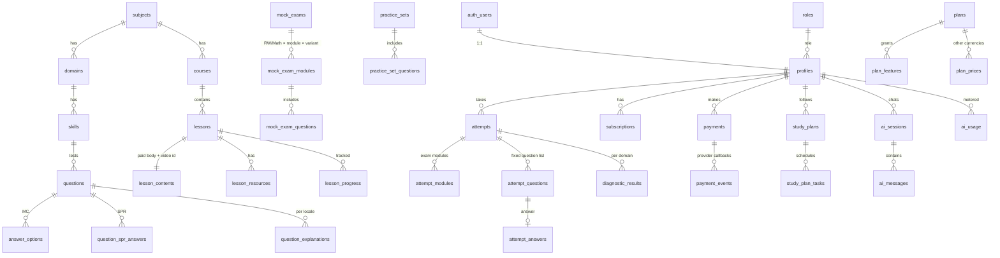

# SAT MASTER — Database Schema

Source of truth: `supabase/migrations/*.sql` (applied in order). Generated types: `src/types/database.ts` (`npm run db:types`). Last updated: 2026-11-02.

**Conventions:** UUID primary keys (`gen_random_uuid()`) except `rate_limits` (composite infrastructure key); `created_at`/`updated_at` timestamptz with `set_updated_at` triggers; soft deletion through `archived_at`/`deleted_at`/status rather than `DELETE` for content; money in **minor units** (`bigint`, tiyin for UZS); enumerations as `text` + `CHECK` (easy to extend without enum migrations); JSON only where the data is genuinely schemaless (raw provider payloads, audit snapshots, validated AI output, settings values).

## 1. Entity map



## 2. Tables

| Area | Table | Purpose & key constraints |
|---|---|---|
| Identity | `roles` | 5 role keys with `rank` for the assignment hierarchy |
| | `profiles` | 1:1 with `auth.users` (trigger `handle_new_user` creates it, always as `STUDENT`). Onboarding fields with range checks (target 400–1600 step 10; 10–600 min/day). `locale ∈ en/uz/ru` |
| Curriculum | `subjects`, `domains`, `skills` | Digital SAT framework (reference data migration). Composite unique `(id, subject_id)` / `(id, domain_id)` back composite FKs |
| | `courses`, `lessons` | Public metadata. Publish guard trigger requires media/notes |
| | `lesson_contents` | Paid body text and video asset id — **staff-only RLS**, served via API after entitlement check |
| | `lesson_resources`, `lesson_progress` | Progress unique per `(user_id, lesson_id)`; written only by the server |
| Questions | `questions` | Composite FKs guarantee skill ∈ domain ∈ subject. `stimulus_type` checks (passage/image required). `status` draft→reviewed→published→archived; trigger `questions_guard_status` blocks publishing incomplete questions; version bump on content edits |
| | `answer_options` | Labels A–D, partial unique index = at most one correct |
| | `question_spr_answers` | Accepted SPR values (regex + length ≤ 6) |
| | `question_explanations` | Unique `(question_id, locale)`; English required to publish |
| | `practice_sets`, `practice_set_questions` | Curated sets |
| Assessment | `diagnostic_tests` | Config only; questions drawn from the bank at start |
| | `mock_exams`, `mock_exam_modules`, `mock_exam_questions` | Module unique `(exam, section, module_number, variant)`; module 1 must be `standard` |
| | `attempts` | One row per practice/diagnostic/exam session; kind-specific checks; partial unique = one in-progress attempt per user per exam/diagnostic; unofficial estimate columns |
| | `attempt_modules` | Exam module runtime state; `started_at`/`deadline_at` required once started; `correct_count` NULL until finalized |
| | `attempt_questions` | Question list fixed at start (`unique nulls not distinct (attempt, module, position)`) |
| | `attempt_answers` | Unique per attempt question; `is_correct` NULL until scored |
| | `diagnostic_results` | Per-domain accuracy + level band |
| | `user_daily_activity` | Daily rollup (streaks, study time) |
| Billing | `plans`, `plan_prices`, `plan_features` | Feature keys: `diagnostic, video_lessons, practice_questions_daily, ai_requests_daily, mock_exams_monthly, analytics_full, study_plan`; `limit_value NULL = unlimited` |
| | `subscriptions` | Partial unique: one `active` row per user; delete blocked |
| | `payments` | `number` identity = merchant order id; unique `(user_id, idempotency_key)` and `(provider, provider_transaction_id)`; Payme state/time columns; delete blocked |
| | `payment_events` | Raw verified/unverified callbacks; unique `(provider, provider_event_id)` = idempotency; delete blocked |
| AI & plans | `study_plans`, `study_plan_tasks` | One active plan per user |
| | `ai_sessions`, `ai_messages`, `ai_usage`, `ai_generated_questions` | Usage with tokens, USD micro-cost, status, latency |
| Platform | `telegram_accounts` (0016) | One Telegram user ↔ one account; written only by the server after HMAC-validating Telegram launch data; students read their own row |
| | `ai_quota_reservations` (0015) | AI requests in flight; counted with today's usage so parallel requests cannot exceed the daily limit. Server only, no client privileges |
| Platform | `bookmarks` | Exactly one of question/lesson |
| | `notifications`, `audit_logs` (append-only), `platform_settings`, `rate_limits`, `contact_requests` | |

## 3. Functions

| Function | Caller | Purpose |
|---|---|---|
| `current_app_role()`, `has_any_role()`, `is_staff()`, `is_content_manager()`, `is_admin()`, `can_view_students()` | RLS policies | Role checks (security definer, suspended users get no role) |
| `question_is_complete(id)` | trigger, editor | Publish readiness |
| `admin_upsert_question(jsonb)` | content managers | Atomic question + options + SPR + explanations save; options upserted by label so history keeps its references |
| `question_set_status(id, status)` | staff | Review workflow (teachers: reviewed; content managers: publish/archive/draft; publish requires reviewed) |
| `admin_set_user_role`, `admin_set_user_suspended` | admins | Hierarchy enforced in SQL; no self-changes |
| `admin_dashboard_metrics()` | admins | All overview KPIs from live tables |
| `get_entitlements(user)`, `my_entitlements()` | server / student | Effective plan features (falls back to `free`) |
| `subscription_effective_status(status, period_end)`, `billing_grace_days()` | internal | active / grace / expired / canceled |
| `billing_apply_successful_payment(payment, tx)` | service role (webhooks) | Idempotent, row-locked, creates/extends/upgrades subscription with pro-rata credit, notifies, audits |
| `billing_mark_payment_failed`, `billing_cancel_pending_payment`, `billing_refund_payment` | service role | Payment state transitions |
| `skill_performance(user)`, `my_skill_performance()` | server / student | Per-skill accuracy from scored answers |
| `activity_streak(user, today)`, `record_daily_activity(...)` | server | Streaks and daily rollups |
| `rate_limit_hit(key, limit, window)` | server | Fixed-window limiter |
| `ai_reserve_request(user, since, limit)` | service role | Atomic daily AI limit: per-student advisory lock, counts successful requests since `since` plus reservations in flight, inserts a reservation if below the limit. Reservations older than 10 minutes are purged |
| `mock_exam_start_attempt(user, exam, since, limit)` | service role | Atomic monthly mock-exam limit: per-student lock, count and insert in one step; `limit` NULL = unlimited |
| `write_audit_log(...)`, `audit_row_change()` | internal | Audit (row trigger on 18 staff-managed tables) |

## 4. Access matrix (RLS + grants)

`—` = no privilege. "Own" = `user_id = auth.uid()`. Service role (server) bypasses RLS and is used only after DAL checks.

| Table group | anon | student | teacher | content editor | admin |
|---|---|---|---|---|---|
| subjects, domains, skills | read | read | read | read/write | read/write |
| courses, lessons | read published | read published | read all | read/write | read/write |
| lesson_contents | — | — (API only) | read | read/write | read/write |
| lesson_progress, attempts*, attempt_answers, diagnostic_results, user_daily_activity, study_plans* | — | read own | read all | read own | read all |
| questions, answer_options, spr answers, explanations | — | — | read | read/write (delete drafts) | read/write |
| practice_sets / diagnostic_tests / mock_exams | — | read published | read all | read/write | read/write |
| practice_set_questions, mock_exam_questions | — | — | read | read/write | read/write |
| plans, plan_prices, plan_features | read active public | read active public | same | same | read/write |
| subscriptions, payments | — | read own | read own | read own | read all |
| payment_events, audit_logs, contact_requests | — | — | — | — | read |
| ai_sessions, ai_messages | — | read own | own | own | own |
| ai_usage | — | read own | own | own | read all |
| ai_generated_questions | — | — | read | read | read |
| bookmarks | — | CRUD own | own | own | own |
| notifications | — | read own, update `read_at` | own | own | own |
| platform_settings | read public | read public | read public | read public | read all, update |
| profiles | — | read own, update whitelisted columns | read all | read own | read all (role changes via function) |
| rate_limits | — | — | — | — | — |

Writes to attempts, progress, subscriptions, payments, AI tables, study plans and activity happen **only** through the server (service role) after validation — there are no client `INSERT/UPDATE` grants on them.

## 5. Integrity guarantees worth knowing

- Students cannot read answer keys through any path: no grants on key tables, `is_correct` withheld during timed tests, and the server serializes `SafeQuestion` objects.
- Financial rows (`payments`, `payment_events`, `subscriptions`) cannot be deleted, even by the service role (trigger). Corrections are state changes with an audit row.
- `audit_logs` is append-only (update and delete triggers).
- A published question always has an English explanation and a valid key; a published lesson always has playable media or notes.
- Plan limits that are checked and then consumed (daily AI requests, monthly mock exams) are enforced inside one SQL function under a per-student lock, so simultaneous requests cannot all pass the check (0015, with a parallel-connection test).
- Payment application is idempotent at three levels: unique provider event ids, unique provider transaction ids, and the `status = 'succeeded'` early return under a row lock.

## 6. Testing the schema locally

```bash
scripts/db/test-db.sh start        # throwaway Postgres 16 cluster on :54329
scripts/db/test-db.sh reset --seed # Supabase shim + all migrations + dev seed
npm run db:types                   # regenerate src/types/database.ts
npm run test:db                    # RLS / function integration tests
```


## Study guides (migration 0013, content 0014)

| Table | Purpose | Access |
|---|---|---|
| `guides` | One row per guide: `slug`, `kind` (`skill` \| `strategy`), `skill_id` (one live guide per skill), `subject_id`, `position`, `reading_minutes`, `status` | Students read published; content managers write; publish guard requires content |
| `guide_contents` | Per-locale `title`, `summary`, `sections` (jsonb, validated by `src/features/guides/schema.ts`) | Students read content of published guides; content managers write |
| `guide_reads` | `(user_id, guide_id)` read marks | Students read/insert/delete their own, for published guides only |

Both content tables carry the audit trigger. See [GUIDES.md](GUIDES.md).
